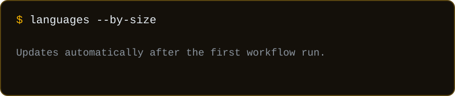

<strong>🎓 BS Software Engineering student at Air University Kamra, building Python backends and applied ML projects.</strong>

## 👋 About

I'm studying Software Engineering at Air University Kamra (2023 – 2027). My coursework covers object-oriented design, data structures, databases and software architecture, and I use internships and small projects to put it into practice.

I'm aiming at **Python backend development**: REST APIs, relational data models, and code that others can maintain. In parallel, my AI/ML internships have given me practice with the Python data workflow: preparing datasets, splitting training and test data, and reviewing where a model's predictions fall short.

My public work so far is a set of C++ programs from CodeAlpha, four Python tasks from Decode Labs, and a hostel-management platform (ASKFlow) that is still in planning.

| | |
|---|---|
| 🎓 **Education** | BS Software Engineering, Air University Kamra (2023 – 2027) |
| 📍 **Location** | Attock, Punjab, Pakistan |
| 🎯 **Focus** | Python backend development · REST APIs · applied AI/ML |
| 🏗️ **Planning** | ASKFlow, a hostel operations platform |

## 🛠️ Tech Stack

**🟢 Used in my internships and repositories**

**🔍 Exploring in AI/ML internship exercises**

`NumPy` `pandas` `scikit-learn`

**📚 Studied in coursework**

`SQL` `OOP` `Data Structures & Algorithms` `DBMS` `Assembly (MASM)`

**🌱 Learning for backend work**

`REST APIs` `OpenAPI`

## 🚀 Featured Projects

### 🧠 [DecodeLabs_Tasks](https://github.com/AalyanShoukatKhan/DecodeLabs_Tasks)
Four Python tasks from my Decode Labs AI internship: a rule-based chatbot, a KNN classifier on the Iris dataset, a TF-IDF technology recommender, and an OCR pipeline.

### ⚙️ [CodeAlpha_Tasks](https://github.com/AalyanShoukatKhan/CodeAlpha_Tasks)
C++ programs from my CodeAlpha internship, written for practice in OOP and problem-solving: a CGPA calculator, a login system, a Sudoku solver and a hotel management system.

### 📓 [AIML-Internship-AalyanShoukatKhan](https://github.com/AalyanShoukatKhan/AIML-Internship-AalyanShoukatKhan)
Labs, assignments and practice work from my AI/ML internship programme.

### 🏨 [ASKFlow](https://github.com/AalyanShoukatKhan/ASKFlow) · in planning
A hostel operations platform for student records, room allocation, attendance, maintenance and daily administration. The repository currently contains only the project description; no code has been published yet.

🎒 Other work from university courses, not published as repositories: a C++ student management system, a C++ library management system, a data-structures project on user and ride management, and a Flutter recipe organiser.

## 📡 Live from GitHub

Everything in this part is generated by a GitHub Action from my real repositories, refreshed daily.

<!--START_SECTION:stats-->
<!--END_SECTION:stats-->

Share of code by size, not a measure of skill.

## 📂 All Repositories

<!--START_SECTION:all-->
<!--END_SECTION:all-->

## 🗂️ Projects by Language

<!--START_SECTION:bylang-->
<!--END_SECTION:bylang-->

## 💼 Experience & Education

- 🌐 **Web Developer Intern, GETWEBMAKER** · 07/2026 – Present. Responsive interfaces in HTML, CSS and JavaScript; UI troubleshooting.
- 🤖 **AI Intern, Zynvex Solutions** · 07/2026 – Present · Remote. AI/ML fundamentals in Python: preprocessing and model evaluation.
- 🧪 **AI Intern, Decode Labs** · 06/2026 – Present · Remote. Python and machine-learning workflows, from dataset preparation to reviewing predictions.
- 💻 **Programming Intern, CodeAlpha** · 03/2026 – 07/2026. C++, object-oriented concepts, debugging and basic testing.

🎓 **BS Software Engineering**, Air University Kamra · 2023 – 2027
🏫 **HSSC Pre-Engineering**, Cadet College Rawalpindi · 2022 – 2024
🗣️ Languages: English, Urdu, Punjabi, Pashto, Arabic

## 📬 Connect

I'm happy to talk about internships, API design or database modelling.

